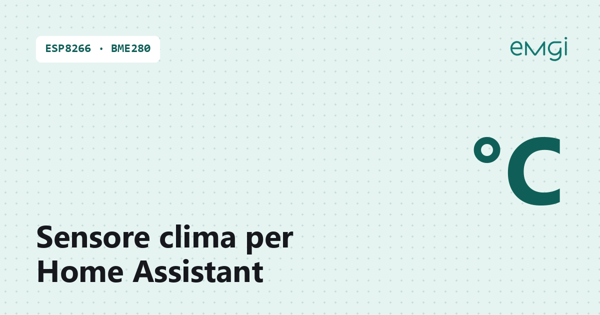

# Sensore Temperature, Umidità e Pressione per Home Assistant

> 📖 **Articolo completo con schema, foto e spiegazioni passo passo:**  
> **[Sensore Temperature, Umidità e Pressione per Home Assistant – www.emgi.it](https://www.emgi.it/2026/04/03/sensore-temperature-umidita-e-pressione-per-home-assistant/)**
>
> Altri progetti di elettronica, Arduino, ESP32, Home Assistant e stampa 3D su **[www.emgi.it](https://www.emgi.it)**

Questo progetto si integra in Home Assistant. Se non l’hai ancora installato, parti dalla guida [Come installare Home Assistant su Raspberry Pi 4, 5 e Zero](https://www.emgi.it/2026/04/14/installare-home-assistant-su-raspberry-pi/).

Monitorare i parametri ambientali in tempo reale è uno dei modi più semplici e utili per rendere davvero intelligente una casa o un laboratorio. In questo progetto ho realizzato un sensore Wi-Fi compatibile con Home Assistant, capace di rilevare **temperatura**, **umidità** e **pressione atmosferica** in modo continuo e affidabile.

## A cosa serve

Un sensore di questo tipo può essere utile in molti scenari:

- monitoraggio climatico di una stanza
- controllo ambiente in laboratorio
- verifica condizioni in cantina, garage o soffitta
- attivazione automatica di ventole, deumidificatori o notifiche
- raccolta dati per statistiche e analisi nel tempo

## Componenti utilizzati

Per questo progetto è possibile usare una scheda Wi-Fi compatta come ESP32 o ESP8266, insieme a un sensore adatto alla rilevazione ambientale.

Componenti tipici:

- scheda **ESP8266** **WEMOS D1 Mini V4.0.0**
- sensore ambientale **BME280** **+** **AHT20** (modulo unico) oppure altra combinazione equivalente per temperatura, umidità e pressione
- alimentazione USB
- eventuale case stampato in 3D
- cavi Dupont e basetta di supporto

## Collegamenti elettrici

Scheda: **Wemos D1 mini** (ESP8266) con modulo combinato **AHT20 + BMP280** (I2C). Pin verificati sullo sketch (`I2C_SDA 4`, `I2C_SCL 5`, `Wire.begin(I2C_SDA, I2C_SCL)`).

| Wemos D1 mini | Modulo AHT20 + BMP280 |
|---|---|
| **3V3** | VCC (VIN) |
| **GND** | GND |
| **D2 / GPIO4** | SDA |
| **D1 / GPIO5** | SCL |

- Alimenta il modulo a **3,3 V**.
- Il case ([`case_3d`](case_3d)) tiene il sensore separato dal D1 mini: il calore della scheda falserebbe la temperatura.

- Il Wemos D1 mini si alimenta dalla sua USB a 5 V; il modulo prende i 3,3 V dal pin **3V3**, non serve altro.
- I moduli I2C hanno già le resistenze di pull-up a bordo: non servono resistenze esterne.

## Contenuto del repository

| Percorso | Descrizione |
|---|---|
| `Sensore_Ambientale_ESP8266/Sensore_Ambientale_ESP8266.ino` | Sketch Arduino |
| `case_3d/wemos_d1mini_aht20_bmp280_case.scad` | Sorgente OpenSCAD parametrico |
| `case_3d/wemos_d1mini_aht20_bmp280_case.stl` | Modello 3D da stampare |
| `immagini/` | Foto e immagini dell'articolo |

## Come si usa

1. Apri [`Sensore_Ambientale_ESP8266.ino`](Sensore_Ambientale_ESP8266) con Arduino IDE.
2. Modifica SSID, password WiFi, IP e gateway (righe 7-11) e il nome del sensore.
3. Il case è parametrico: [`case_3d/wemos_d1mini_aht20_bmp280_case.scad`](case_3d) si apre con OpenSCAD.

Schema dei collegamenti, dettagli e risoluzione dei problemi: **[articolo su www.emgi.it](https://www.emgi.it/2026/04/03/sensore-temperature-umidita-e-pressione-per-home-assistant/)**.

## Licenza

- Codice e configurazioni: [MIT](LICENSE)
- Modelli 3D, schemi e immagini: [CC BY-SA 4.0](https://creativecommons.org/licenses/by-sa/4.0/deed.it)

---

**Autore:** Massimiliano Sandrin – **[eMGi.it](https://www.emgi.it)** · Domande e commenti sotto l'[articolo sul sito](https://www.emgi.it/2026/04/03/sensore-temperature-umidita-e-pressione-per-home-assistant/).
